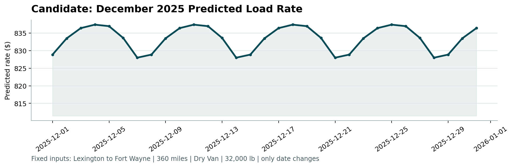

# freight rate prediction

result: the final model is off by about 4.3% per load (102 dollars on an average load of 2,392 dollars), after fixing several data quality problems: negative weights, missing values, target leakage and unexplained outlier loads.

predicts the posted rate of a freight load from its route, distance, equipment, weight and date. built for the spotter ml engineer assessment.

this is version 2, rebuilt from scratch in october. the first version is still in the commit history.

what changed from v1:

* found and fixed negative weights (a sign error) that v1 missed
* found that quote_signal is target leakage (v1 only dropped it because it was missing from the december file)
* the final model is retrained on all data through october (v1 never trained on september and october)
* added a leakage safe lane feature and averaged random forest with lightgbm
* test MAE went from 106.92 to 102.45

## how to run

put the assessment files in `data/` then:

```
pip install -r requirements.txt
python train.py
python score.py --predictions validation_predictions.csv --december-predictions data/december_chart_inputs.csv
```

train.py prints the test scores, then writes `validation_predictions.csv` and fills `data/december_chart_inputs.csv`. score.py checks both files and makes the december chart.

## files

* `train.py`: the full pipeline, cleaning to final predictions
* `exploration_clean.ipynb`: the data exploration with every finding and decision
* `validation_predictions.csv`: predictions for the 12,000 validation loads
* `report.pdf`: split approach, results and the december chart
* `scorer_results/candidate_december.png`: the december chart

## what i found in the data

* rates are seasonal (11% swing, peak in june) and depend a little on the weekday (2.6%, wednesday and thursday highest)
* equipment changes the rate: reefer costs about 13% and flatbed about 8% more per mile than dry van (median 2.31 and 2.22 vs 2.05 dollars per mile)
* about 670 loads (1.4%) have rates far above or below normal and nothing explains them (not distance, equipment, weight, date or route). removed from training only and kept in the test
* 292 negative weights in training and 145 in validation. they closely mirror the positive weights so it is a sign error, fixed with abs()
* 300 missing weights in training and 165 in validation, filled with the training median
* weights are clipped at 5,000 and 47,500
* quote_signal is target leakage: its scatter plot against rate per mile is an X shape (two exact lines plus noise), so it was dropped
* market_index shows no signal and is missing from the december file, so it was dropped

## business view

* the final model is off by about 102 dollars per load on average. the average load in the test period costs about 2,392 dollars, so that is roughly 4.3% per load
* the rate is driven mostly by distance, then by equipment, season (11% swing) and weekday (2.6%)
* about 1.4% of loads are priced far above or below normal with nothing in the data explaining them. in real freight these could be urgent or expedited spot loads (expensive), backhauls where a truck accepts a low rate to get home, or entry mistakes (cheap). a spot or contract flag and the booking lead time would probably explain many of them
* what would improve the model most: data from previous years to learn december and holidays, diesel prices, a spot or contract flag, and booking lead time
* how it could be used: as a starting quote for a load, with unusual lanes and holiday periods flagged for a person to check

## split

time based: train on january to august, test on september and october, because the real task is predicting two unseen future months. a random split would let the model see the future. the final model is retrained on all of january to october.

## results (test on september and october)

| model | MAE |
|---|---|
| baseline (median rate per mile x distance) | 256.94 |
| random forest | 106.45 |
| random forest + lane feature | 105.67 |
| lightgbm + lane feature | 107.84 |
| average of random forest and lightgbm | 102.45 |

the lane feature is the typical rate per mile of each pickup and delivery pair, computed with an out of fold target encoder so a load never sees its own price.

## december chart



## limitation

the training data ends in october so the model never saw december or any holiday. the december chart shows a weekly pattern only, christmas looks like a normal thursday. data from previous years would fix that.
